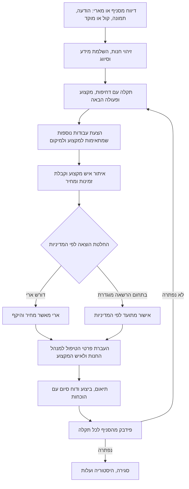

# OPC — יעד המוצר, תהליך אחד ותוכנית השלמה

> מסמך מיפוי היסטורי מהסבב הראשון. [גרסה 2.1](OPC_SPEC_V2_1.md) היא האפיון המחייב; [מפת הפערים המעודכנת](OPC_GAP_ANALYSIS_V2_1.md) משקפת את הקוד הנוכחי. בפרט, אין להסיק מהצעת הספים במסמך זה אישור אוטומטי להוצאה, או סמכות למטה לאשר תיקון במקום החנות.

עודכן: 10.11.2026. בסיס הביקורת: `main` ב־`b2383c2`; תיקוני הסבב בענף `fix/ari-workflow-alignment`.

## מה מחייב את הפרויקט

רשימת 13 היכולות שמסר בעל הפרויקט בשיחה היא **הגדרת היעד המאושרת מול ארי**, ולא הצהרה שכל יכולת פועלת בפרודקשן. מסמך זה מחבר אותה לאפיון מ־2.11.2026, לממצאי קוד ולתוכנית ביצוע אחת. הוא אינו אישור עלייה לאוויר.

המטרה: ניהול תחזוקה לרשת מרובת סניפים, עם אוטומציה מקצה לקצה וארי כגורם החלטה, אישור הוצאות וטיפול בחריגים. כל 13 התחומים נשארים במוצר. הפשטות נובעת מאיחוד התהליכים והצגת הפעולה הבאה בהקשר, ולא ממחיקת יכולות או בקרות.

הביקורת נעשתה מול קוד המקור ובסביבה מקומית עם נתוני זיכרון. חיבורי Meta/WhatsApp, מודלי AI, מסד נתונים אמיתי, מסירה לנמענים, משימות מתוזמנות והתקנת PWA במכשיר אמיתי דורשים בדיקה נפרדת. קיום קוד או בדיקה מדומה אינו הוכחת פעולה בפרודקשן.

## התהליך הראשי

מסלול אישור אוטומטי בתוך ספי מדיניות הוא חלק מהיעד החדש, אך הספים עצמם לא נמסרו. עד להגדרתם אין להסיק סמכות אישור אוטומטית ואין לאפשר ל־AI לאשר הוצאה מעצמו.

כללים שאסור לפישוט הממשק לשבור:

1. התקלה והעבודות הנדרשות מכתיבות את איש המקצוע; עצם בחירת ספק אינה סיבה לפתוח ביקור.
2. כל עבודות הביקור חייבות להתאים למקצוע, למיקום ולזמינות. שילוב עבודה לא דחופה לא יעכב טיפול דחוף. עבודות ממקצועות שונים דורשות פיצול או התאמה מפורשת לכל המקצועות.
3. מחיר מאושר, הצעת מחיר, חשבונית ותשלום בפועל הם נתונים שונים. שינוי מחיר, ספק או היקף דורש בדיקת אישור מחדש.
4. אישור התקשרות אינו הוכחה שהעבודה בוצעה. בקשת משוב נשענת על אירוע ביצוע ומועד רלוונטי.
5. אישור סניף מתייחס לתקלה שהוצגה לו. אין לסגור תקלות נוספות או סניף אחר בעקבות אישור יחיד.
6. ביקור משולב מסתיים רק אחרי שכל התקלות הכלולות בו אושרו. את העלות המשותפת סופרים פעם אחת, עם הקצאה מפורשת בדוחות.
7. כשל הודעה אינו הצלחת מסירה. נשמרים מצב השמירה, מצב השליחה והאפשרות לניסיון חוזר בלי כפל ביקור או הודעות.
8. לא מוחקים מידע שנשמר כששלב מאוחר נכשל. שגיאות מסד אינן אמורות להיראות כהצלחה שנשמרה בזיכרון בלבד בסביבת ייצור.

## מפת 13 היכולות מול הקוד

"חלקי" פירושו שיש מימוש שימושי, אך עדיין קיימים פערים מהיעד או שחיבור חיצוני לא אומת. אין בתחום כלשהו סימון "מוכן לפרודקשן" בסבב זה.

| # | היכולת המאושרת | מה נמצא בקוד | מה חסר להשלמת היעד |
|---|---|---|---|
| 1 | קליטת תקלות אוטומטית ב־WhatsApp | הודעות, שמירת מדיה, תמלול קול, זיהוי סניף, שאלות הבהרה ופתיחת קריאה; מסלול לבדיקה אנושית בכשל | תמונה נשמרת אך אינה מפוענחת; אימות חי של webhook, קובץ, תמלול, שאלות, יצירה מתמשכת ומניעת כפילות |
| 2 | אבחון, סיווג ותעדוף AI | מודל עם fallback לכללים, רצפות בטיחות, זיהוי דמיון לקריאות, SLA והמלצות נפרדות | תוכנית טיפול אחידה, ניתוח תמונות ואיכות סיווג מול מקרי אמת; בדיקת כפילויות ב־DB מוגבלת ל־20 קריאות אחרונות |
| 3 | מחזור חיים מלא | סטטוסים, שיוך, SLA, אירועים, מסלול טכנאי ומסלול התקשרות חיצונית | איחוד שני המסלולים; אירוע ביצוע ברור; החלטה על החזקת האיכות הקיימת ל־30 יום לעומת סגירה לאחר פידבק |
| 4 | מרכז שליטה ארצי | דשבורד, תור, סינון, מרכז פעולות, WhatsApp וכלים | פעולות החלטה משולבות בדף הבית; שיום ומונים שתואמים לנתונים; הצגת שגיאות טעינה וכיסוי מאות סניפים מעבר למגבלות השליפה |
| 5 | איתור ושיבוץ אנשי מקצוע | מאגר, מקצוע וכיסוי, היסטוריית תוצאות, שיגור עם ניסיון חוזר; RFQ ידני | RFQ הוא טיוטה בלבד: חסרים שליחה למספר ספקים ב־WhatsApp, איסוף תשובות והשוואה; זמינות מנוהלת; התאמת כל החבילה; Midrag מורשה |
| 6 | ניהול טכנאי בשטח | פורטל נפרד, עבודות משויכות, התחלת טיפול, תמונות לפני/אחרי וסיכום | אירוע הגעה מפורש; סנכרון ללא רשת אם ייכלל בהיקף; איחוד הוכחות ביצוע גם לאיש מקצוע חיצוני ובדיקת מסלולי server action חלופיים |
| 7 | אימות ביצוע מול סניף | אישור/דחייה, פורטל חנות ותזכורת | נמען הסניף צריך להיות נפרד מהמדווח המקורי; עיתוי אחרי ביצוע; אימות מסירת WhatsApp. תוקנו בסבב זה סגירת תקלות אחרות והרשאת אישור לא משויכת |
| 8 | אישורי הוצאות והצעות | רישום הצעה, התחייבות, חסימה לפני אישור ואישור מחדש בשינוי; נעילת מחיר במסלול התקשרות | איחוד RFQ/עסקה/הוצאה, השוואת הצעות, ספי מדיניות והרשאות; ביטול מסלול אישור שיגור במחיר 0 כתחליף למחיר מוסכם |
| 9 | עלויות והמלצות | אומדנים, הישנות, עלות ציוד, הפרדת שולם/מאושר/ממתין ודירוג תוצאות | מקור כספי אחיד, השוואת ספקים מלאה ומודל תיקון מול החלפה. אין עדיין מחיר החלפה, עלות השבתה או בסיס אחיד לכל הדוחות |
| 10 | סניפים, ציוד והיסטוריה | מדינה/אזור/סניף, אנשי קשר, ציוד, ברקוד והיסטוריה | ייבוא כללי מהטבלאות הקיימות, מיפוי ושגיאות ייבוא, מניעת כפילויות ואימות תחום הרשאה לכל רשימה/כתיבה |
| 11 | כיולים ואישורים תקופתיים | אודיומטר וטימפנומטר 12 חודשים; תא אקוסטי 24 חודשים; תעודות, גרסאות וחידוש; cron תזכורות | אימות קובץ נגיש ותאריך לפני חידוש; זיהוי תעודות חסרות בסניפים הרלוונטיים; תיעוד מסירה וניסיונות חוזרים בלי תזכורות זהות בכל יום |
| 12 | דוחות ומדדים וייצוא | מדדי קריאות וזמני טיפול, SLA, השוואת חנויות, דוח שנתי, ארכיון ו־CSV/Excel/PDF | נתוני ספקים ומגמות, התאמה בין מקורות כספיים, סינון אחיד לפי הרשאה/סניף/טווח; טיפול בתקרת 5,000 קריאות וב־PDF של 120 שורות בלי להסתיר קיטוע |
| 13 | הרשאות, אבטחה ואוטומציה | ארבעה תפקידי מוצר עם מיפוי תפקידי עבר, בדיקות תחום, RLS/היררכיה, הוכחות במסלול טכנאי ועקיפה מנומקת של ארי | בדיקת מסלולים עם system client, הוכחות במסלול חיצוני, אמינות מסד ומשימות; מיגרציות, סודות, מסירה וניסיונות חוזרים טרם אומתו בפרודקשן |

### מקורות קוד עיקריים

| תחום | קבצים |
|---|---|
| קליטה ו־AI | [`intake.ts`](../src/modules/whatsapp/intake.ts), [`intake-agent.ts`](../src/modules/whatsapp/agent/intake-agent.ts), [`voice.ts`](../src/modules/whatsapp/voice.ts), [`media.ts`](../src/modules/whatsapp/media.ts), [`duplicates.ts`](../src/modules/whatsapp/agent/duplicates.ts) |
| מסלולי טיפול | [`engagements/service.ts`](../src/modules/engagements/service.ts), [`visits/service.ts`](../src/modules/visits/service.ts), [פעולת אישור השיגור ההיסטורית שהוסרה](https://github.com/YoniLevy10/OPC/blob/820e6c1/src/app/ops/tickets/visit-approval-actions.ts), [`engagement-panel.tsx`](../src/app/ops/tickets/[id]/engagement-panel.tsx) |
| בחירה ואיגוד | [`bundle.ts`](../src/modules/whatsapp/agent/bundle.ts), [`visit-multi-select.tsx`](../src/app/ops/tickets/visit-multi-select.tsx), [`live-results.ts`](../src/modules/vendors/midrag/live-results.ts), [`rfq/draft.ts`](../src/modules/rfq/draft.ts) |
| ארי וסגירה | [`agent-actions.ts`](../src/modules/ops/agent-actions.ts), [`store-confirm.ts`](../src/modules/tickets/store-confirm.ts), [`confirm/route.ts`](../src/app/api/tickets/[id]/confirm/route.ts), [`lifecycle-notify.ts`](../src/modules/notifications/lifecycle-notify.ts), [`lifecycle-nudge`](../src/app/api/cron/lifecycle-nudge/route.ts) |
| מסמכים וכיולים | [`rules.ts`](../src/modules/documents/rules.ts), [`calibrations.ts`](../src/modules/documents/calibrations.ts), [`document-reminders`](../src/app/api/cron/document-reminders/route.ts), [`notify/ari.ts`](../src/modules/notify/ari.ts) |
| נתונים והרשאות | [`roles.ts`](../src/lib/auth/roles.ts), [`types.ts`](../src/lib/auth/types.ts), [`stores API`](../src/app/api/stores/route.ts), [`assets API`](../src/app/api/assets/route.ts), [`proof-gate.ts`](../src/modules/tickets/proof-gate.ts) |
| כספים ודוחות | [`policy.ts`](../src/modules/spend/policy.ts), [`true-cost.ts`](../src/modules/spend/true-cost.ts), [`engagements/cost.ts`](../src/modules/engagements/cost.ts), [`export/route.ts`](../src/app/api/reports/export/route.ts), [`export-formats.tsx`](../src/modules/reports/export-formats.tsx) |

## הממשק הרצוי

שלושה יעדים ראשיים: **דשבורד, תקלות, WhatsApp**. במובייל כפתור "עוד" פותח את הכלים המשניים; בדסקטופ קבוצות הכלים מתקפלות. מסמכים, אישורים, אנשי מקצוע, סניפים, ציוד, דוחות ומשתמשים ממשיכים להתקיים לפי הרשאה.

דף הבית צריך לענות על "מה צריך ממני עכשיו": פעולה, חנות, סיבה, סכום אם רלוונטי וכפתור המשך אחד. לדוגמה: "בחר איש מקצוע", "אשר הצעה — 850 ₪", "בדוק חריגת חשבונית", "חדש תעודת כיול". המתנה לטכנאי או לסניף אינה החלטה תקציבית חדשה של ארי.

"מה דורש פעולה" הוא כיום מרכז שמאגד חריגות, הוצאות, משימות, מסמכים ואימותים. זה אינו סוג עבודה חדש. המלצת היעד היא להציג את הפעולות הרלוונטיות בדשבורד, ולהשאיר את המרכז כתצוגה מפורטת במקום לשונית נוספת שצריך להבין.

"אישורים" אינו תהליך נפרד מהטיפול. אישור מחיר והיקף צריך להופיע בשלב הבחירה/ההצעה, עם הסבר קצר מה מאשרים. העברת הלשונית לתפריט משני היא צעד ראשון בלבד; היא אינה משלימה את איחוד הבקרה בתוך מסלול העבודה.

מסך תקלה: תחילה מה קרה, באיזה סניף, דחיפות, מי אחראי ומה הפעולה הבאה. היסטוריה, חישובי עלות ומידע טכני נפתחים לפי צורך. פתיחה ידנית צריכה להיות אפשרית לארי מתוך מרכז השליטה, בנוסף לעוזר ול־WhatsApp.

מסך שיבוץ: תחילה התקלות שנכללות והמקצועות הנדרשים, אחר כך אנשי מקצוע מתאימים. עבודות שאינן מתאימות מוצגות לפיצול. קישור מידרג מסונן יכול להיות פתרון ביניים; המימוש הנוכחי קורא HTML ציבורי ואינו מוכיח שקיים חיבור מורשה.

השפה החזותית תישאר אחידה: RTL, רקעים אטומים בחלונות, אותו סף מעבר למובייל/דסקטופ, ריווח עקבי, כפתורי מגע גדולים, מצב כהה קריא וסידור מאוזן לרוחבים קטנים. המיתוג והצבעים הקיימים אינם דורשים החלפת ספריית UI כדי להגיע לשם.

## תוכנית ביצוע אחת

הסדר הבא הוא המלצת ביצוע; הוא אינו טענה שהשלבים הפתוחים כבר מומשו.

| שלב | עבודה | תנאי סיום | תלות |
|---|---|---|---|
| 0 — יציבות | חלון שקוף, תוצאת שיגור, אישור פרטני והרשאת אישור; בדיקת APIs עם system client והוכחות במסלול חיצוני | אין היעלמות מסך, סגירה של עבודה אחרת או שינוי חוצה הרשאה; בדיקות נסיגה ממוקדות | ללא תלות |
| 1 — מסלול אחד | לאחד התקשרות, ביקור והוצאה; להגדיר מתי עבודה בוצעה; לקבע איש קשר של החנות; התאמה לכל מקצוע בחבילה | מסע אחד מדיווח ועד סגירה, כולל כשל/ניסיון חוזר, בלי שני אישורי מחיר סותרים | 0 |
| 2 — UX ופשטות | ניווט מצומצם, פתיחה ברורה, פעולות החלטה בדשבורד, אישור בהקשר ופרטים משניים מתקפלים | ארי מצליח לפתוח, לבחור, לאשר ולעקוב בלי הדרכה על מונחי המערכת | 1; תיקוני תצוגה יכולים להתקדם במקביל |
| 3 — קליטה וספקים | טקסט/קול/תמונה מקצה לקצה; RFQ רב־ספקים, תשובות והשוואה; הגדרת מדיניות תקציב וחיבור מידרג מורשה אם נבחר | בקשות אמיתיות מקושרות להצעות ולעסקה; אין אישור אוטומטי בלי ספים והרשאות | 1 |
| 4 — מסמכים ונתונים | אימות קובץ וחידוש, תעודות חסרות, יומן תזכורות, ייבוא טבלאות עם מיפוי ודוח שגיאות | מסמך נפתח, משויך, מחודש ונזכר ללא כפילות; ייבוא חוזר אינו מכפיל רשומות | 0; במקביל ל־1–3 |
| 5 — כספים ותובנות | מקור מסחרי אחיד, תשלום בפועל, השוואת ספקים, תיקון מול החלפה, יצוא מסונן ומגמות | סכומי תקלה/סניף/ציוד/רשת והייצוא מתיישבים עם אותם נתוני מקור | 1, 3, 4 |
| 6 — קבלת מערכת | מסעות מלאים בכל תפקיד, בדיקת חיבורים חיים ו־PWA על מכשיר | ראיות למסירה, שמירה, הרשאות, הוכחות ותפעול מאות סניפים; אישור קבלה של ארי | יתר השלבים |

### חסמים פתוחים שכבר זוהו בקוד

- רשימות החנויות והציוד ב־API משתמשות ב־system client לאחר בדיקת כניסה, ללא סינון מספק לפי תחום המשתמש. נדרשת בדיקה ותיקון לפני טענה לבידוד מלא.
- דרישת הוכחות ביצוע חלה במעבר ל־`resolved`, אך מסלול `engaged → closed` אינו עובר באותה בקרה. יש לאחד זאת עם עקיפה מנומקת ומבוקרת, בלי לבלבל אישור הזמנת עבודה עם הוכחת ביצוע.
- קיים server action חלופי ב־`modules/tech/actions.ts` המקבל `techId` מהלקוח, ללא אימות מקומי; לא נמצא שימוש בו בביקורת. יש להסיר או להגן עליו ולבדוק חשיפה בפועל.
- התאמת ספק לביקור משתמשת ב־`some` על מקצועי התקלות; התאמה לאחת אינה מספיקה לכולן. המלצות איגוד כוללות גם אותו מחוז, בלי התאמת מקצוע מלאה.
- מסלול שיגור מאפשר אישור התחייבות ב־0 כשהמחיר לא נעול. מסלול ההתקשרות דורש מחיר מוסכם חיובי. צריך מודל אחד שמכסה גם עבודת אבחון מוסכמת, אם זה תרחיש נדרש.
- נעילת התקשרות אינה יוצרת רשומת Spend תואמת. RFQ, הוצאות והתקשרויות הם מקורות נפרדים; זו סיבה אפשרית לפער בין מחיר בתקלה לדוח השנתי.
- ייצוא קורא לפנקס ההוצאות בלי hydration מפורש; חלק העלות השנתית אינו מחיל את מלוא סינון ההרשאה/סניף/טווח. נדרשות בדיקות נתונים והרשאות, ולא רק עיצוב דוח.
- תזכורת פידבק עלולה לצאת כמה שעות אחרי אישור התקשרות, לפני ביקור. תקלה שנפתחה דרך הסוכן בלי טלפון מדווח עלולה לא לקבל תזכורת כי הנמען נגזר מהמדווח.
- חידוש מסמך מסתפק בקישור לא ריק; תזכורות יכולות להישלח בכל הרצה יומית, וכשל שליחה יכול להיבלע בלי סימון אי־מסירה.

## בדיקות קבלה שמגדירות "עובד"

| מסע | מה חייבים להוכיח |
|---|---|
| עובד שולח הודעה/תמונה/קול | זיהוי סניף, שאלת חוסר, תקלה אחת עם המקור והקבצים, סיווג והופעה בדשבורד; כפילות webhook אינה יוצרת תקלה נוספת |
| ארי פותח מהמוקד/העוזר | יצירה בלי החלפת תפקיד, שיוך לחנות הנכונה, תיעוד זהות הפותח ונמען חנות להמשך הטיפול |
| תקלה מסוכנת | תעדוף והסלמה לפי מדיניות; כשל מודל אינו מוריד רצפת בטיחות; אפשרות תיקון החלטה מתועדת |
| בחירת עבודות ואיש מקצוע | תקלות מובילות לבחירה, התאמה לכל מקצוע/מיקום, אי־עיכוב הדחוף ופיצול מה שלא מתאים |
| RFQ ואישור הוצאה | בקשה למספר נמענים מורשים, תשובות מקושרות, השוואה, מחיר והיקף מאושרים לפני התחייבות; חריגה ממתינה לארי |
| ביצוע טכנאי | רק עבודות משויכות, הגעה/התקדמות, קבצים לפני/אחרי וסיכום; אין גישה לדשבורד ארי |
| אימות וסגירה | רק המשתמש המורשה של החנות מאשר; אישור אחד אינו סוגר אחים; דחייה מחזירה לטיפול; עקיפת ארי מחייבת סיבה ותיעוד |
| מסירה וניסיון חוזר | הבחנה בין שמירה למסירה; נמען חסר וכשל Meta/SMS גלויים; ניסיון חוזר אינו יוצר כפילויות |
| מסמכים וכיולים | פתיחת הקובץ, סוג/סניף/תאריך נכונים, מחזור 12/24 חודשים, תעודה חסרה ותזכורת בשלב הנכון; חידוש שגוי אינו מעלים חוסר |
| היסטוריה ודוחות | סכום מאושר לעומת שולם, עלות משותפת פעם אחת, סינון משתמש/חנות/תקופה בכל מסך וייצוא, התאמה בין CSV/Excel/PDF |
| הרשאות | ארבעת תפקידי המוצר, משתמש לא משויך, אותו תפקיד בארגון אחר, טכנאי אחר, חריגי ארי והיעדר התחזות דרך מזהי לקוח |
| אמינות | מסד מנותק, מיגרציה חסרה, מקור נתונים שלא נטען, כשל cron/שליחה, אתחול שרת ורענון; הנתונים אינם נעלמים אחרי restart |

### קבלת PWA ומובייל

- בדיקת דפים וחלונות ב־375, 390, 430, 768, 1024 ו־1440 פיקסלים: אין גלילה אופקית, חיתוך כפתורים או חלון שקוף; אור/חושך ו־RTL.
- iPhone Safari והתקנה למסך הבית; Android Chrome והתקנה; פתיחה מחדש, deep link והתחברות חוזרת.
- מקלדת פתוחה, safe areas, צילום/העלאה, טופס ארוך, גלילה בתוך חלון, סגירה ומיקוד נגיש.
- רשת איטית/ניתוק: הצלחה מוצגת רק לאחר שמירה; שגיאה ניתנת לשחזור; עדכון service worker לא מוחק טופס באמצע.
- מאות סניפים: pagination ושאילתות מסוננות; אין טענה למספר כולל כשהדשבורד שלף רק מדגם מוגבל.

## החלטות שנותרו להגדרה

אלו פרטים שלא הוגדרו ברשימת היכולות, ולא סיבה לדחות תיקוני תקלות או ביקורת:

- סכומי הסף, מטבע/מע״מ, בעלי סמכות ומדיניות חירום; אילו הוצאות מותר לאשר אוטומטית.
- מחיר לביקור מול מחיר לתקלה, וחלוקת מחיר משותף בין סניפים/ציוד.
- מי מדווח על גמר עבודה אצל איש מקצוע חיצוני, ומה עושים כשהסניף לא משיב.
- מדיניות החזקת האיכות ל־30 יום הקיימת בקוד מול הסגירה המיידית במסלול ההתקשרות.
- מבנה הטבלאות שייובאו, ופרטי החיבור המורשה למידרג אם יידרש.
- חלונות תזכורת והסלמה למסמכים; ארבעת תפקידי המוצר כבר קיימים, אך סמכויות העוזר והחריגים דורשים התאמה מפורשת לארי.

## מה השתנה בסבב זה

- בוטלה דריסת העיצוב שהפכה את `BottomSheet` לשקוף במובייל. חלונות שומרים רקע אטום, גבולות וגלילה פנימית.
- תוצאת שיגור נשמרת גם כשהתור מתרענן. ההקשר לניסיון חוזר נשמר; הבחירה מתנקה בסגירת תוצאה מוצלחת.
- אישור חנות סוגר רק את התקלה שאושרה. ביקור והעלות השנתית שלו נסגרים רק כשכל התקלות מאושרות וסגורות; כשל בשמירת הפידבק מונע סגירה.
- נקודת אישור התיקון בודקת ארגון, שיוך חנות או סמכות HQ בתחומה. טכנאי אינו יכול לספק את אישור החנות; משתמש מחובר ללא הרשאה נחסם גם בדמו.
- הניווט הראשי צומצם לשלושה יעדים. אישורים נשארים בכלי התפעול עם מונה; קבוצות בדסקטופ מתקפלות ונפתחות לפי הדף הפעיל.
- נוסף כפתור "תקלה חדשה" בדשבורד של ארי ובתור למורשים. טופס הפתיחה משתמש באותו סף 1024px של מעטפת המערכת.

זהו סבב ראשון של סדר, תיקוני ליבה ופישוט כניסה. הוא אינו מימוש מלא של 13 היכולות, אינו איחוד מלא של שני מסלולי הטיפול ואינו בדיקת קבלה בפרודקשן. פירוט תוצאות הבדיקות והחסמים נמצא ב־[`qa/ARI_ALIGNMENT_VALIDATION.md`](qa/ARI_ALIGNMENT_VALIDATION.md).
